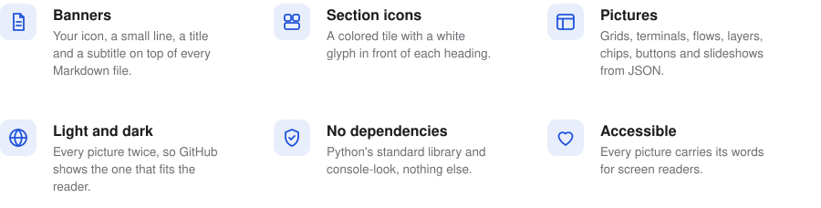
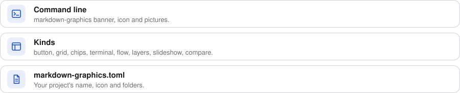

<p align="center">
  
</p>

Draws the graphics that make a README or a guide easy to read, in one shared style: a banner on top, a colored icon
in front of each section, and pictures of lists, terminals, flows and layers, each in a light and a dark version so
GitHub shows the one that fits the reader. The pictures are drawn from small JSON files, so they stay in version
control and change with a single line.

## What it does

<picture>
  <source media="(prefers-color-scheme: dark)" srcset="assets/pictures/features-dark.svg">
  
</picture>

## Install

Python 3.13 or newer, on macOS or Linux. Screenshots in slideshows and comparisons need macOS (`sips`).

```bash
pip install git+https://github.com/Robertwlt03/markdown-graphics@v0.1.0
```

## Use

Run the commands in your project's root. A `markdown-graphics.toml` there names your project; every setting is
optional:

```toml
name = "My Project"          # on banners and in their text for screen readers (default: the folder's name)
icon = "assets/icon.svg"     # your icon on banners (default: a blue tile with a prompt mark)
assets = "assets"            # banners, and icons/ for the section icons
pictures = "docs/pictures"   # one <name>.json per picture
pictures_out = "assets/pictures"
shots = "snapshots/current"  # screenshots for slideshows and comparisons
hand_drawn = ["footer"]      # banners the command never replaces
```

<picture>
  <source media="(prefers-color-scheme: dark)" srcset="assets/pictures/terminal-dark.svg">
  
</picture>

```bash
markdown-graphics banner
```

```bash
markdown-graphics banner release-notes "Release notes" "What changed in each version."
```

```bash
markdown-graphics icon install green download
```

```bash
markdown-graphics pictures
```

- `banner` without texts asks for everything and offers to replace an existing banner. `--theme claude` draws it in
  Claude's ivory and clay, together with a matching footer, which suits a CLAUDE.md.
- `icon` takes a color (`blue`, `green`, `orange`, `clay` … see `--help`) and a glyph name such as `download`, or
  your own SVG shapes in a 24-point grid.
- `pictures` draws every description, or only the ones you name.

Show a picture with `<picture>`, so the dark version appears in dark mode, and put all of its words in the alt text:

```html
<picture>
  <source media="(prefers-color-scheme: dark)" srcset="assets/pictures/features-dark.svg">
  
</picture>
```

## How it works

<picture>
  <source media="(prefers-color-scheme: dark)" srcset="assets/pictures/flow-dark.svg">
  .json names a kind and its items. 2 Draw: markdown-graphics pictures writes a light and a dark SVG. 3 Show: <picture> in the Markdown file picks the right one." width="100%">
</picture>

Every description names its `kind`. Most kinds take a list of `items`, each with a glyph, a title and a sentence;
the descriptions in [`docs/pictures`](docs/pictures) drew every picture on this page.

| Kind | Draws |
|---|---|
| `button` | a macOS push button with a glyph and a title; `"style": "primary"` fills it |
| `grid` | items in columns; with `"code": true` the title is a command or path in a monospace chip |
| `chips` | a flag (`"flag": "DE"`) or a short code with a name and a second name, such as languages |
| `terminal` | a window that types its commands; lines are `[kind, text]` with `command`, `output`, `result`, `note` and `cursor` (the prompt waiting, its cursor blinking); an output's text may be pieces such as `["Made at ", ["accent", "ACME"]]`; `"width"` narrows it, such as for a phone |
| `flow` | numbered steps from left to right with arrows |
| `layers` | stacked rows for parts that build on each other, the top one first |
| `slideshow` | SVGs or screenshots that fade into each other with a caption |
| `compare` | one screenshot light and dark, with a divider that slides between them |

<picture>
  <source media="(prefers-color-scheme: dark)" srcset="assets/pictures/layers-dark.svg">
  
</picture>

<picture>
  <source media="(prefers-color-scheme: dark)" srcset="assets/pictures/languages-dark.svg">
  
</picture>

<p>
  <picture><source media="(prefers-color-scheme: dark)" srcset="assets/pictures/button-install-dark.svg"></picture>
</p>

No picture paints a background, so each sits on the page like text; slideshows, comparisons and terminals move with
SVG's own animation, which GitHub plays.

## Contribute

Issues and pull requests are welcome. Install it editable, then run the tests:

```bash
pip install -e .
```

```bash
python3 -m unittest discover -s Tests
```

## License

[MIT](LICENSE)
